# 🦀 AirsStack

**An AI and Rust based framework and building tools for software factories.**

airsstack is the open-source foundation for *factory engineering*: the framework and tools to design, build, run, and improve a software factory. We are AI-first and Rust-first, but never AI-only. Every tool and product here works with AI agents or without them. Everything is open source and used by us to build our own products.

## What is a software factory?

A software factory is a repeatable system that turns intent into shipped software: standardized inputs, a defined path, automated quality control, and AI agents doing much of the work at each station while humans define intent and review the evidence [1][2]. The idea is decades old; what is new is who staffs the line [1].

We use **factory engineering** for the work of designing, operating, and improving the factory itself, as distinct from the software that comes out of it. That is the work airsstack exists to support.

Our take is deliberately opinionated:

- **AI-first, not AI-only.** The tools are designed for agents to drive, and they are just as usable by an engineer working by hand. AI is a first-class option, never a requirement.
- **The human is the architect.** Specs, decisions, and knowledge are written down, versioned, and owned by you. Whoever executes against them, human or agent, works from the same record.
- **The line must be trustworthy.** Builds are deterministic and sandboxed. Tools declare what they are allowed to touch.
- **The factory does not stop at "shipped".** Construction is one phase. Operation, maintenance, and scale belong to the same system [3].

## The factory floor

airsstack has two kinds of projects. **Tools** make up the factory floor: libraries and CLIs you can use directly. **Products** are what the floor builds, and the proof that it works. The diagram below shows how they relate.

```mermaid
%% airsstack Factory Floor
flowchart LR
    subgraph WHO["Who works the line"]
        direction LR
        ENG["Engineer<br/>intent, specs, decisions"]
        AGENTS["AI agents<br/>optional, first-class"]
    end

    subgraph TOOLS["Tools: libraries and CLIs"]
        direction LR
        STACKS["claudestacks"]
        OR["openrouter-rs"]
        BUILD["buildl"]
        AIRSL["airsl"]
        AIRSL -.->|"powers"| BUILD
    end

    subgraph PRODUCTS["Products: what the floor builds"]
        direction LR
        VAULT["AirsVault<br/>today"]
        MORE["More products<br/>later"]
    end

    ENG -->|"uses directly"| TOOLS
    ENG -.->|"directs"| AGENTS
    AGENTS -.->|"optional"| TOOLS
    TOOLS --> PRODUCTS
    PRODUCTS -.->|"feedback"| ENG

    style ENG fill:#2e4636,stroke:#7fb589
    style AGENTS fill:#4a3f2a,stroke:#c9a35c
    style STACKS fill:#4a3f2a,stroke:#c9a35c
    style OR fill:#4a3f2a,stroke:#c9a35c
    style BUILD fill:#4a2e2e,stroke:#c96b6b
    style AIRSL fill:#4a2e2e,stroke:#c96b6b
    style VAULT fill:#3a2e4a,stroke:#9b7fc9
    style MORE fill:#3a2e4a,stroke:#9b7fc9
```

An engineer can run the whole line alone, or hand stations to AI agents. The tools are the same either way. Feedback from every product, such as review findings and failures, flows back into your specs and decisions, so the factory gets better at building your software over time. New tools and new products slot into the same picture.

## Tools

Libraries and CLIs, ready to consume with or without AI.

| Project | What it is | Status |
|---|---|---|
| [**airsl**](https://github.com/airsstack/airsl) | Embedded Lua runtime in Rust. Powers buildl. | Ready |
| [**buildl**](https://github.com/airsstack/buildl) | Sandboxed, deterministic build system. Build files are written in Lua, evaluated in two phases (declare, then execute), and must declare the authority they need. | In development |
| [**claudestacks**](https://github.com/airsstack/claudestacks) | The Claude-focused Rust stack: [**airsclaude**](https://crates.io/crates/airsclaude), an unofficial Rust SDK for Anthropic's Claude; [**claudevs**](https://crates.io/crates/claudevs) (CLI: [**claudevs-cli**](https://crates.io/crates/claudevs-cli)), a deterministic test engine for Claude Code plugins; and a Claude Code plugin suite that packages our spec-driven methodology, including the `claudestacks-sdlc` workflow. | Ready |
| [**openrouter-rs**](https://github.com/airsstack/openrouter-rs) | Rust SDK for OpenRouter. One client, many models. | Ready |

## Products

| Project | What it is | Status |
|---|---|---|
| [**AirsVault**](https://github.com/airsstack/airsvault) | Local-first desktop app for technical founders and solo builders. A markdown knowledge vault plus persistent AI virtual team roles that work from your specs and notes. AI is optional: the vault stands on its own without a model. Built in Rust with GPUI. macOS first. | In development |

## Where we are, honestly

Today airsstack covers the **build** side of the factory: a set of tools you can use now, and the first product made with them. The **framework** that ties the pieces into one factory, along with **maintain** and **scale**, are the direction, not yet the inventory. We add tools when a real product of ours needs them, never before: AirsVault is built with the tools beneath it, so nothing here exists on trust alone.

## How we build

Short version: spec in, software out. We build airsstack with our own tooling: the `claudestacks-sdlc` plugin for Claude Code, which implements Anthropic's AI-native SDLC playbook [4] at single-author scale. Work moves through a committed chain of four stages, with two feedback loops.

```mermaid
%% claudestacks-sdlc workflow
flowchart LR
    INTENT["intent<br/>what and why"] --> DESIGN["design<br/>spec"]
    DESIGN --> PLAN["plan<br/>ordered, parallelizable plans"]
    PLAN --> EXEC["execute<br/>reviewed, verified diff"]
    EXEC -.->|"review findings"| DISTILL["distill<br/>recurring findings become<br/>proposed config edits"]
    FAIL["Failure evidence<br/>logs, reports"] -.-> TRIAGE["triage<br/>evidence becomes a new intent"]
    TRIAGE -.-> INTENT

    style INTENT fill:#2e4636,stroke:#7fb589
    style DESIGN fill:#2e4636,stroke:#7fb589
    style PLAN fill:#2e4636,stroke:#7fb589
    style EXEC fill:#2e4636,stroke:#7fb589
    style DISTILL fill:#4a3f2a,stroke:#c9a35c
    style TRIAGE fill:#4a3f2a,stroke:#c9a35c
    style FAIL fill:#4a2e2e,stroke:#c96b6b
```

- **Gated stages.** Each stage reads the recorded state of the one before it. A draft intent cannot be designed, and an unapproved plan cannot be executed.
- **Everything is a committed file.** Intents, specs, and plans live in the repository, and nothing is deleted, only superseded or dropped. No decision lives only in a conversation.
- **Proven, not assumed.** Before a task relies on a fact a plan asserts, `execute` checks it. Independent work runs in parallel, and each batch is reviewed.
- **Feedback loops.** `distill` turns findings that recur across chains into proposed configuration edits. `triage` turns failure evidence into a new intent. Both wait for your approval before changing anything.
- **Open standards over house formats.** Knowledge is stored in plain markdown and open formats you can take anywhere.
- **Apache-2.0** across the ecosystem.

## Get involved

Pick a project above, read its README, and open an issue or discussion. Contributions are accepted under the DCO.

## References

1. TrueFoundry. *The Agentic Software Factory, Explained: History, Architecture, and Enterprise Controls*. 2026. URL: <https://www.truefoundry.com/blog/software-factory-agentic-enterprise-guide>
2. Plannotator. *What Is an AI Software Factory? How Agent-Native Software Delivery Works*. 2026. URL: <https://docs.plannotator.ai/learn/ai-development/what-is-an-ai-software-factory>
3. BCG Platinion. *The Agentic Software Factory*. 2026. URL: <https://www.bcgplatinion.com/insights/the-agentic-software-factory>
4. Claxton, Louis. *The AI-native SDLC playbook*. Claude Blog, Anthropic, 2026. URL: <https://claude.com/blog/the-ai-native-sdlc-playbook>
