# 🦀 AirsStack

**Open-source building blocks for software factories.**

airsstack provides the tools, libraries, and frameworks to build, maintain, and scale software with AI agents working alongside you. Everything here is open source, Rust-first, and used by us to build our own products.

## What is a software factory?

A software factory is a repeatable system that turns intent into shipped software: standardized inputs, a defined path, automated quality control, and AI agents doing much of the work at each station while humans define intent and review the evidence [1][2]. The idea is decades old; what is new is who staffs the line [1].

Our take is deliberately opinionated:

- **The human is the architect.** Specs, decisions, and knowledge are written down, versioned, and owned by you. Agents execute against them.
- **The line must be trustworthy.** Builds are deterministic and sandboxed. Tools declare what they are allowed to touch.
- **The factory does not stop at "shipped".** Construction is one phase. Operation, maintenance, and scale belong to the same system [3].

## The factory floor

Every airsstack project plays a role on the floor. The diagram below shows how they fit together.

```mermaid
%% airsstack Factory Floor
flowchart LR
    YOU["You<br/>intent, specs, decisions"] --> VAULT["AirsVault<br/>control room"]
    VAULT --> AGENTS["Agent workforce<br/>plugins, clauders,<br/>openrouter-rs"]
    PARTS["OpenMod<br/>parts catalog"] --> AGENTS
    AGENTS --> BUILD["buildl + airsl<br/>build machinery"]
    BUILD --> OUT["Software<br/>built, maintained, scaled"]
    OUT -.->|"knowledge and lessons"| VAULT

    style YOU fill:#2e4636,stroke:#7fb589
    style VAULT fill:#3a2e4a,stroke:#9b7fc9
    style AGENTS fill:#4a3f2a,stroke:#c9a35c
    style PARTS fill:#4a3f2a,stroke:#c9a35c
    style BUILD fill:#4a2e2e,stroke:#c96b6b
    style OUT fill:#2e4636,stroke:#7fb589
```

You stay at the front of the line. Knowledge flows back into the vault after every cycle, so the factory gets better at building your software over time.

## Projects

### Control room

| Project | What it is | Status |
|---|---|---|
| [**AirsVault**](https://github.com/airsstack/airsvault) | Local-first desktop app for technical founders and solo builders. A markdown knowledge vault plus persistent AI virtual team roles that work from your specs and notes. Built in Rust with GPUI. macOS first. | In development |

### Build machinery

| Project | What it is | Status |
|---|---|---|
| [**buildl**](https://github.com/airsstack/buildl) | Sandboxed, deterministic build system. Build files are written in Lua, evaluated in two phases (declare, then execute), and must declare the authority they need. | Design complete |
| [**airsl**](https://github.com/airsstack/airsl) | Embedded Lua runtime that powers buildl. | Design |

### Agent workforce

| Project | What it is | Status |
|---|---|---|
| [**plugins**](https://github.com/airsstack/plugins) | Claude Code plugin suite: spec-driven workflows, journaling, and knowledge tooling for agent-assisted development. | TODO |
| [**clauders**](https://github.com/airsstack/clauders) | Rust SDK for Anthropic's Claude. | TODO |
| [**openrouter-rs**](https://github.com/airsstack/openrouter-rs) | Rust SDK for OpenRouter. One client, many models. | TODO |

### Parts catalog

| Project | What it is | Status |
|---|---|---|
| [**OpenMod**](https://github.com/airsstack/openmod) | Catalog of runnable, stack-agnostic open-source modules. Standard parts your agents can assemble instead of reinventing. | TODO |

## Where we are, honestly

Today airsstack covers the **build** side of the factory. **Maintain** and **scale** are the direction, not yet the inventory. We add tools when a real product of ours needs them, never before: AirsVault is built with the stacks beneath it, so nothing here exists on trust alone.

## How we build

Short version: spec in, software out.

- **Spec-driven.** Architecture docs, ADRs, and work breakdowns are the shared memory of the project. Humans and agents both work from them.
- **Everything is a committed file.** No decision lives only in a conversation.
- **Open standards over house formats.** Knowledge is stored in plain markdown and open formats you can take anywhere.
- **Apache-2.0** across the ecosystem.

## Get involved

Pick a project above, read its README, and open an issue or discussion. Contributions are accepted under the DCO.

## References

1. TrueFoundry. *The Agentic Software Factory, Explained: History, Architecture, and Enterprise Controls*. 2026. URL: <https://www.truefoundry.com/blog/software-factory-agentic-enterprise-guide>
2. Plannotator. *What Is an AI Software Factory? How Agent-Native Software Delivery Works*. 2026. URL: <https://docs.plannotator.ai/learn/ai-development/what-is-an-ai-software-factory>
3. BCG Platinion. *The Agentic Software Factory*. 2026. URL: <https://www.bcgplatinion.com/insights/the-agentic-software-factory>
