# 🦀 airsstack

**Open-source tools for the agentic software factory.**

An *agentic software factory* is a software development lifecycle (SDLC) where AI agents do the work at every stage (spec, plan, build, verify, operate) while humans own the intent, the decisions, and the review. airsstack builds the tools for that factory, in the open, with Rust at the core.

## Principles

- **AI-first, not AI-only.** Every tool is designed for agents to drive, and every tool works just as well for an engineer by hand.
- **Nothing is ambient.** A script, a build, or an agent gets only what it declared and was granted. Anything else is refused, and the refusal says what was missing.
- **The human owns the intent.** Specs and decisions are committed files. Whoever executes against them, human or agent, works from the same record.
- **Integrate, don't compete.** We don't build yet another agent framework. We build the parts that frameworks such as DSPy and LangGraph can run on.
- **Open by default.** Plain markdown and open formats, Apache-2.0 across the ecosystem.

## The map

airsstack has two lanes that stand on one shared foundation.

```mermaid
%% airsstack map
flowchart TB
    subgraph A["Run the factory: the agentic SDLC"]
        direction LR
        CTL["airsstack<br/>controller CLI"]
        SDLC["agentstacks<br/>agent tool setup: packs + extensions"]
        CVS["claudevs<br/>Claude Code test engine"]
        BUILD["buildl<br/>sandboxed builds"]
    end

    subgraph B["Build agentic software"]
        direction LR
        CLAUDE["airsdk-claude<br/>Claude SDK"]
        OR["openrouter-rs → airsdk-openrouter<br/>OpenRouter SDK"]
        BRIDGE["framework bridges<br/>DSPy, LangGraph, ..."]
    end

    subgraph F["Foundation: safe execution"]
        direction LR
        AIRSL["airsl<br/>language sandbox"]
        DEEPER["WASM / VM sandbox"]
    end

    A --> F
    B --> F

    style SDLC fill:#2e4636,stroke:#7fb589
    style CVS fill:#2e4636,stroke:#7fb589
    style CLAUDE fill:#2e4636,stroke:#7fb589
    style OR fill:#2e4636,stroke:#7fb589
    style AIRSL fill:#2e4636,stroke:#7fb589
    style BUILD fill:#4a3f2a,stroke:#c9a35c
    style CTL fill:#3a3a3a,stroke:#888,stroke-dasharray: 4 4
    style BRIDGE fill:#3a3a3a,stroke:#888,stroke-dasharray: 4 4
    style DEEPER fill:#3a3a3a,stroke:#888,stroke-dasharray: 4 4
```



Green is ready, amber is pre-release, and dashed grey is planned.

## Projects

| Project | Lane | What it is | Status |
|---|---|---|---|
| **airsstack** | Run the factory | The front-door CLI, in the spirit of kubectl. `airsstack agent …` hands off to agentstacks, and `airsstack tool install airsl` installs and pins airsstack tools under `$HOME/.airsstack`. Later it will manage whole stacks, with tools as dependencies. | Planned |
| [**agentstacks**](https://github.com/airsstack/agentstacks) | Run the factory | A CLI that sets up agentic coding tools in a project. **Packs** hold tool-neutral content (skills, agents, commands, hooks, rules); **tool extensions** in Lua, sandboxed by airsl, render them in each tool's own format, as a plan you review before it is applied. Claude Code, OpenCode V2 and Muse Code are supported. Version 1.3 releases each extension (`ext-<name>-v*`) and each pack (`packs-<name>-v*`) on its own tag stream; the extension API stays frozen at `api = 1`: `agentstacks ext add` adds a community extension and `agentstacks ext test` checks one. Hosts [**claudevs**](https://crates.io/crates/claudevs), a deterministic test engine for Claude Code setups. | Ready |
| [**buildl**](https://github.com/airsstack/buildl) | Run the factory | A sandboxed, deterministic build system. Build files are written in Lua and must declare the authority they need. | Pre-release |
| [**airsdk**](https://github.com/airsstack/airsdk) | Build agentic software | Thin, provider-specific Rust SDKs for the outside services the factory reaches, starting with model providers. `airsdk-claude` 0.1.0 is published; OpenRouter support is moving in from `openrouter-rs`. | Pre-release |
| [**openrouter-rs**](https://github.com/airsstack/openrouter-rs) | Build agentic software | A Rust SDK for OpenRouter. One client, many models. Moving to airsdk as `airsdk-openrouter` (the `openrouter-rs` name on crates.io belongs to someone else). | Ready |
| [**airsl**](https://github.com/airsstack/airsl) | Foundation | An embedded Lua runtime in Rust. Scripts can touch only what you allow. Powers buildl and the agentstacks hooks. | Ready |

## Safe execution, level by level

Agent frameworks are good at orchestration but weak at isolation: a tool call can usually touch anything. airsstack treats safe execution as the foundation and deepens it one level at a time. Each level enforces the same rule: declare what you need, and get nothing else.

```text
isolation depth ─────────────────────────────────────────────────►
 language            process            WASM             VM
 airsl               buildl             planned          planned
 (ready)             (pre-release)
```

## Languages

| Layer | Language | Role |
|---|---|---|
| Core | **Rust** | SDKs, runtimes, sandboxes, CLIs |
| Scripting | **Lua** | The only scripting language, always sandboxed by airsl: build files, hooks, extensions, test cases |
| Bridge | **Python** (planned) | Bindings so the Python agent ecosystem can call airsstack tools. Python is not a scripting layer here. |

## How we build

We build airsstack with airsstack. Every change moves through the agentstacks `sdlc` pack: **intent → design → plan → execute**. Each stage is a committed file and is gated on the one before it. Review findings that recur are distilled into proposed configuration edits, and failures are triaged into new intents. The workflow follows Anthropic's AI-native SDLC playbook [1] at single-author scale.

## Built with airsstack

- [**AirsVault**](https://github.com/airsvault/airsvault): a super-note-taking app for technical founders, built with the airsstack methodology.

## Where we are, honestly

Today airsstack covers the **spec, build, and verify** stations of the factory, plus the language-level sandbox. The **airsstack** controller, the rest of the airsdk regrouping (`airsdk-openrouter`), the **operate** station, the deeper sandbox levels, and the framework bridges are the direction, not yet the inventory. We add a tool when real work needs it, and we label it planned until it ships.

## Get involved

Pick a project above, read its README, and open an issue or discussion. Contributions are accepted under the DCO. Everything is Apache-2.0.

## References

1. Claxton, Louis. *The AI-native SDLC playbook*. Claude Blog, Anthropic, 2026. URL: <https://claude.com/blog/the-ai-native-sdlc-playbook>
